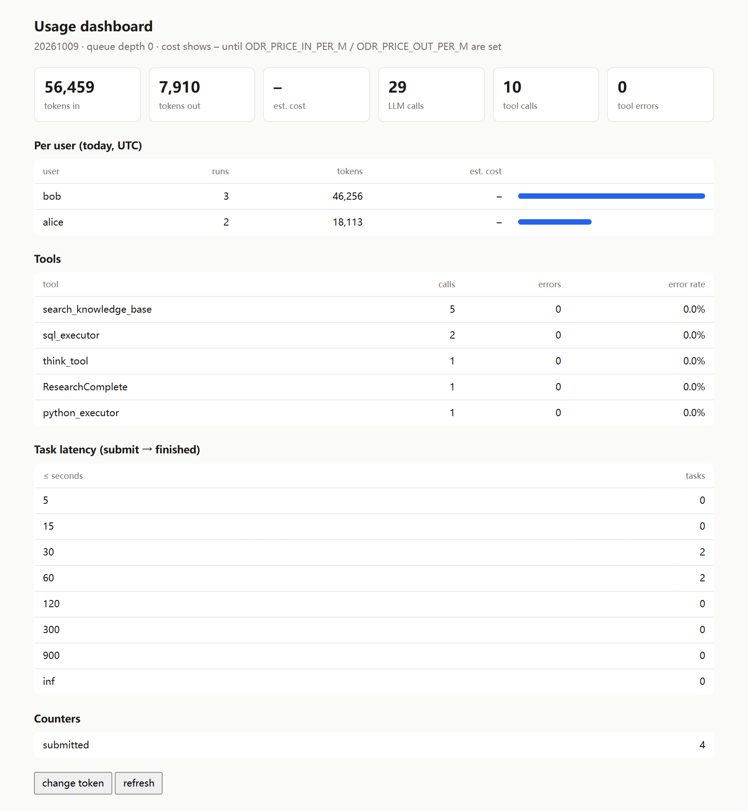
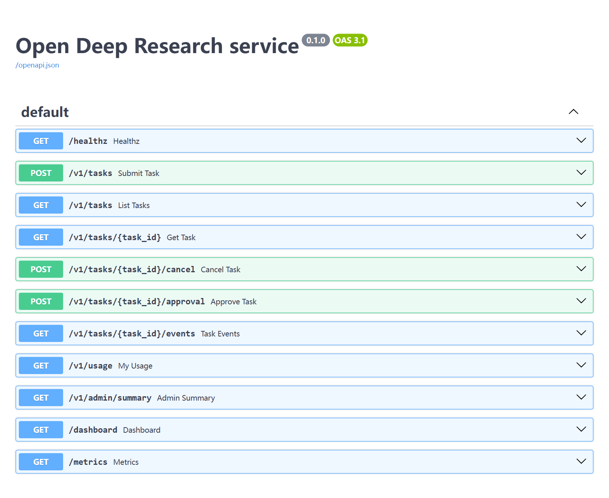
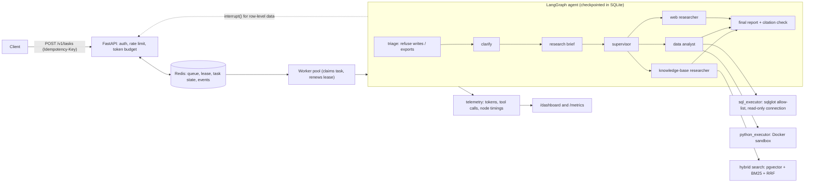

# 企业数据分析 Agent

[](https://github.com/c4002159/open_deep_research/actions/workflows/eval-smoke.yml)

> **Derivative work.** Built on LangChain's open-source [open_deep_research](https://github.com/langchain-ai/open_deep_research) (MIT).
> The multi-agent skeleton (clarify → brief → supervisor → researchers → report) is theirs; their original README is kept in
> [`docs/UPSTREAM_README.md`](docs/UPSTREAM_README.md). Everything listed under "What this fork adds" is new.
>
> **TL;DR (English):** an internal data-analysis agent (SQL over a sales DB + policy-document RAG + statistics) wrapped in the
> engineering an agent needs before anyone should trust it: sandboxed code and read-only SQL, timeouts/retries/circuit breaker/model
> fallback, human approval for confidential queries, a 61-case evaluation suite with baselines, and an async HTTP service with
> idempotency, rate limiting, leases and a usage dashboard. Everything was measured on a **small local setup** (80-row SQLite, 38 KB chunks) — see [Limits](#限制).

面向销售数据分析和制度知识问答的内部数据助手：能查销售库（SQL）、检索公司制度文档（RAG）、做统计分析（沙箱里跑 Python）。
重点不是"能跑"，而是回答：**Agent 上线前，怎么让它不乱来（安全）、不挂掉（可靠）、可度量（评测）、能多人用（服务化）。**

## 演示

真实运行的 4 个任务（行数统计、知识库问答、"删表"请求被拒绝、需要人工审批的统计分析），之后的管理看板与 API：

<p align="center"></p>
<p align="center"></p>

- 「删表」请求在研究开始前就被拒绝：不调用任何工具、不消耗 token（评测脚本里约 0 秒；在服务里它和别的任务一样要等一个空闲 worker）；
- 「算 revenue 与 units 的相关系数」需要读取逐条订单，触发人工审批：提交者自己批准返回 `403`，管理员批准后任务从检查点继续，约 30 秒完成，代码在 Docker 沙箱里执行。

## 这个分支增加了什么

| 能力 | 解决的问题 | 位置 |
|---|---|---|
| **请求分诊** | "删掉 sales 表"这类请求原来会被派去搜网页，耗时 5 分钟；现在研究前由确定性规则拒绝 | `request_triage.py` |
| **SQL 三层防护** | 模型生成的 SQL 可能改库 | `sql_guard.py`：sqlglot 单条 SELECT 白名单 → 只读连接 → 超时与行数上限 |
| **代码沙箱** | 模型生成的 Python 是不可信代码 | `code_sandbox.py`：AST 策略 → 受限子进程 → **Docker（断网 / 256MB / 非 root）**；没有 Docker 默认拒绝执行 |
| **工具可靠性** | 工具与模型天然不稳定 | `resilience.py`、`model_fallback.py`：超时、仅限幂等工具的重试、熔断、模型降级 |
| **人工审批** | 逐条订单金额属于机密数据 | `approval.py`：`interrupt()` 暂停，审批后从检查点恢复；审计日志 |
| **成本与范围控制** | 简单问题被拆成多智能体调研，单题 40 次工具调用 | `prompts.py` 的范围约束 + 按研究员类型的工具总调用预算 |
| **混合检索与引用核验** | 向量检索对精确术语不稳；报告可能引用不存在的文档 | `kb_retrieval.py`（向量 + BM25 + RRF）、`citation_check.py` |
| **记忆治理** | 模型写入的长期记忆含错误事实并被后续运行当真相 | `memory_policy.py`、`schema_context.py`：表结构由数据库实时提供，记忆只存术语 / 用户纠正 / 文档位置 |
| **评测体系** | 改完提示词不知道变好还是变差 | `eval/`：61 条评测集、基线对比、故障注入、压测 |
| **HTTP 服务** | 多人使用 | `service/`：异步任务、幂等、限流、租约队列、SSE、用量看板 |

## 架构



## 怎么跑起来

**前置：**Python ≥ 3.10、[uv](https://docs.astral.sh/uv/)、Docker、一个 LLM 的 API Key（示例用 DeepSeek，任何 LangChain `provider:model` 都行）。

```bash
# 1. 依赖与配置
uv sync
cp .env.example .env            # 填 DEEPSEEK_API_KEY；ODR_API_KEYS 里的 change-me-* 请改掉

# 2. Redis（任务队列 / 状态）、pgvector（知识库）、代码沙箱镜像
docker run -d --name odr-redis -p 6390:6379 redis:7
docker run -d --name pgvector -p 6024:5432 \
  -e POSTGRES_USER=langchain -e POSTGRES_PASSWORD=langchain -e POSTGRES_DB=langchain pgvector/pgvector:pg16
docker build -t agent-sandbox-python:latest -f docker/sandbox.Dockerfile .

# 3. 把 9 篇制度文档切分并写入 pgvector
python docs/internal_kb/build_kb.py

# 4. 启动服务（会读取 .env；第一次启动要预热 embedding 模型，约 20 秒）
export ODR_ADMINS=admin ODR_APPROVERS=admin ODR_API_KEYS="demo-alice:alice,demo-admin:admin"
python -m open_deep_research.service          # http://127.0.0.1:8080  （/docs 是 API 文档）
```

```bash
# 提交任务 → 202 {"id": "...", "state": "queued"}；同一个 Idempotency-Key 重复提交只执行一次
curl -X POST localhost:8080/v1/tasks -H "Authorization: Bearer demo-alice" \
     -H "Idempotency-Key: demo-1" -H "Content-Type: application/json" \
     -d '{"question": "How many records are in the sales table?"}'

curl localhost:8080/v1/tasks/<id>          -H "Authorization: Bearer demo-alice"   # 状态与结果、用量
curl -N localhost:8080/v1/tasks/<id>/events -H "Authorization: Bearer demo-alice"   # SSE 进度
curl -X POST localhost:8080/v1/tasks/<id>/approval -H "Authorization: Bearer demo-admin" \
     -H "Content-Type: application/json" -d '{"approved": true}'                    # 审批人批准
# 管理看板：浏览器打开 http://127.0.0.1:8080/dashboard ，粘贴管理员的 key
```

> Windows 的 Git Bash 里 `curl` 发中文会按本地编码发出而被服务端拒绝，发中文问题请用 Python（`httpx`）或 PowerShell。
> 没有 Docker 时只用于本地开发：`CODE_SANDBOX_BACKEND=auto` 会降级到更弱的子进程沙箱。更多见 [`docs/service.md`](docs/service.md)。

**不起服务、只在命令行里看 Agent 工作**：`python -m eval.trace_case kb_phone_mask`（逐个工具打印调用）。

## 测试与评测

```bash
pytest tests -q                               # 需要 Redis(6390)；连不上时相关测试自动跳过
python -m eval.run_agent_eval --name demo --dry-run          # 不调模型，只验证评测流水线
python -m eval.run_agent_eval --name full --concurrency 3    # 61 条完整评测，会消耗 LLM token
python -m eval.compare eval/baselines/final61.json eval/results/full.json   # 与基线对比
python -m eval.run_security_eval              # 攻击 / 误拦用例（EVAL_BACKEND=docker 测容器）
python -m eval.run_fault_injection            # 离线故障注入（虚拟时间，几毫秒）
python -m eval.service_loadtest               # 服务压测（假图，不含 LLM）
```

## 结果

全部是**本机小规模**的测量，规模写在每一项旁边；复现命令见上。

| 项目 | 结果 | 规模 / 说明 |
|---|---|---|
| 完整评测 | **60/61（98.4%）**，工具调用成功率 99.3% | 自建 61 条、8 类，单次运行；同一代码的上一次也是 60/61，但**失败的不是同一条**，单次运行有 ±1~2 条波动 |
| 范围约束与调用预算 | 平均工具调用 **12.1 → 3.6**，token −64%，仍 8/8 | 知识库 8 条用例 |
| 安全 | 攻击得手 **0 次**，正常用例误拦 0 次 | 55 条（41 攻击 + 14 正常）；旧实现下 19 条代码攻击全部得手 |
| 故障注入（离线模拟） | 随机 30% 失败时调用成功率 **64.9% → 97%**（超时重试） | 600 秒虚拟时间；模型限流场景 67% → 100% |
| 混合检索 | Hit@1 **0.854 → 0.878**，MRR 0.919 → 0.935 | 41 条查询、38 个分块，提升有限 |
| 服务压测 | 228 次提交/秒，P95 792ms；300 并发同 key 仅创建 1 个任务；杀掉全部 worker 后 100/100 任务完成 | 假图替代 LLM，**不是端到端吞吐**；投递为至少一次 |

## 限制

- 数据只有 80 行、2 张表，评测集由同一个人编写；类别样本少，百分比波动大，**不能代表真实业务**。
- 没有真实用户或线上运行，没有长时间稳定性测试，没有多机测试。
- 检查点是 SQLite 文件，只适合单机；多机部署需换 Postgres 检查点。
- 分诊是正则，可被改写绕过（后面还有 SQL 防护、只读连接和沙箱兜底）。
- 内存中的 BM25 只适合几千个分块量级。
- API、worker 和所有工具调用共用**一个事件循环**：工具里任何同步的耗时调用（加载模型、同步 HTTP 客户端）都会卡住所有请求，
  已把已知的几处（embedding 模型加载、mem0 客户端）放进线程并在启动时预热，`tests/test_loop_blocking.py` 守着；新增工具时要注意同样的问题。
- 默认 4 个 worker（`ODR_WORKERS`）：长任务占满 worker 时，后来的短任务（包括被拒绝的请求）要排队。
- 对开放式网页调研场景没有评测，提示词的"范围约束"改动在该场景的影响未验证。

## 目录

```
src/open_deep_research/
  deep_researcher.py      LangGraph 主图（上游，已改：分诊节点、审批闸门、调用预算、熔断/降级接入、引用核验）
  sql_guard.py            code_sandbox.py       安全执行
  resilience.py           model_fallback.py     可靠性
  approval.py             request_triage.py     审批与分诊
  kb_retrieval.py         citation_check.py     检索与引用
  memory_policy.py        schema_context.py     记忆治理
  telemetry.py            query_cache.py        可观测与缓存
  service/                FastAPI 服务（app / store / runner / worker / ratelimit / dashboard）
eval/                     评测集、基线、故障注入、压测、追踪工具
tests/                    单元与集成测试（CI 中全部运行，另有测试保证不会漏）
docs/                     service.md（服务说明）、observability_and_rag.md、internal_kb/（演示用制度文档）
docker/sandbox.Dockerfile 沙箱镜像
```

## 许可

MIT，沿用上游。`LICENSE` 保留 LangChain 的版权声明。
